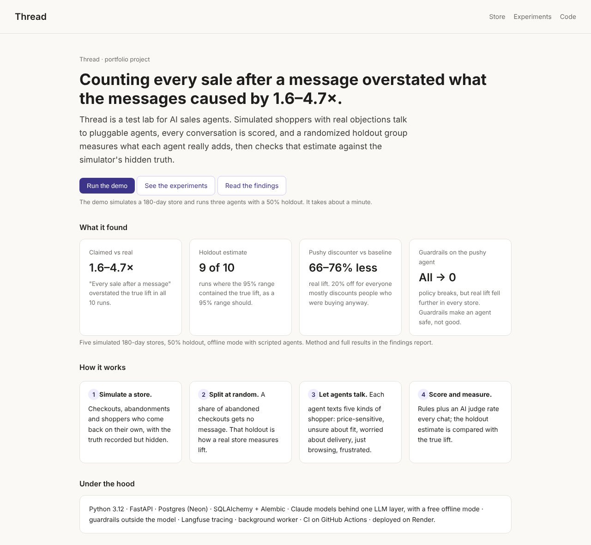
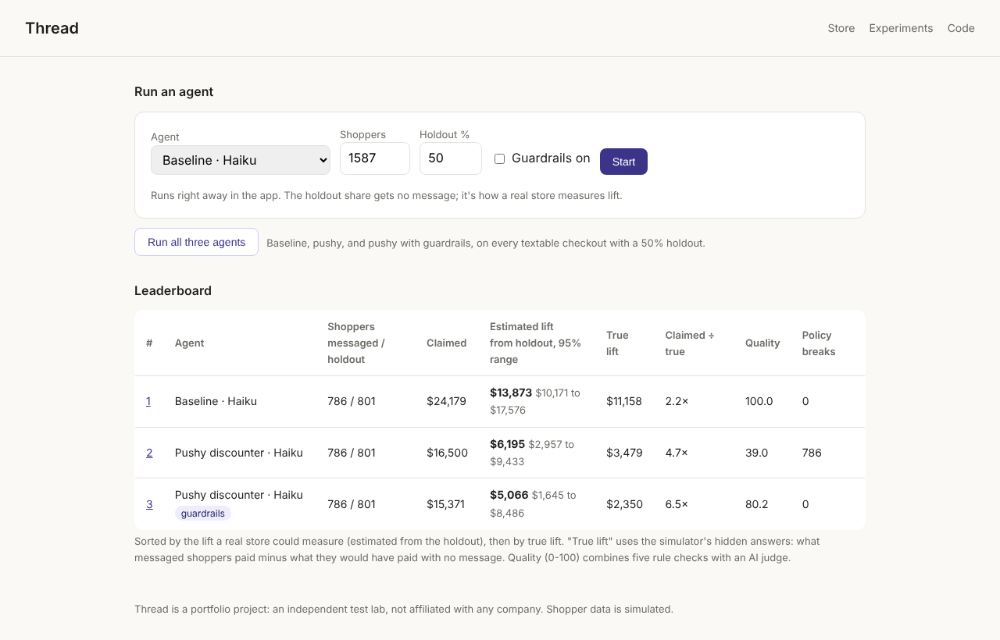
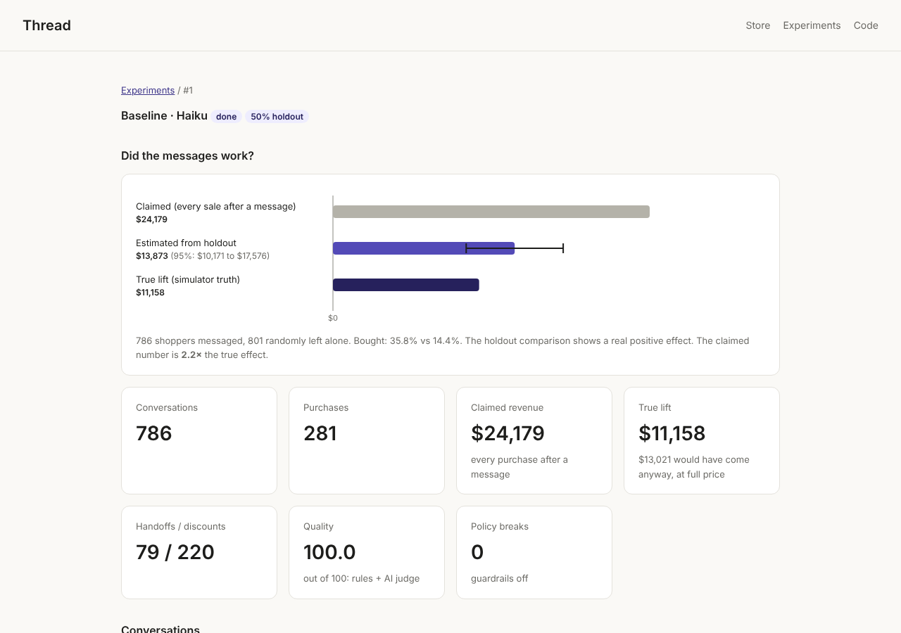
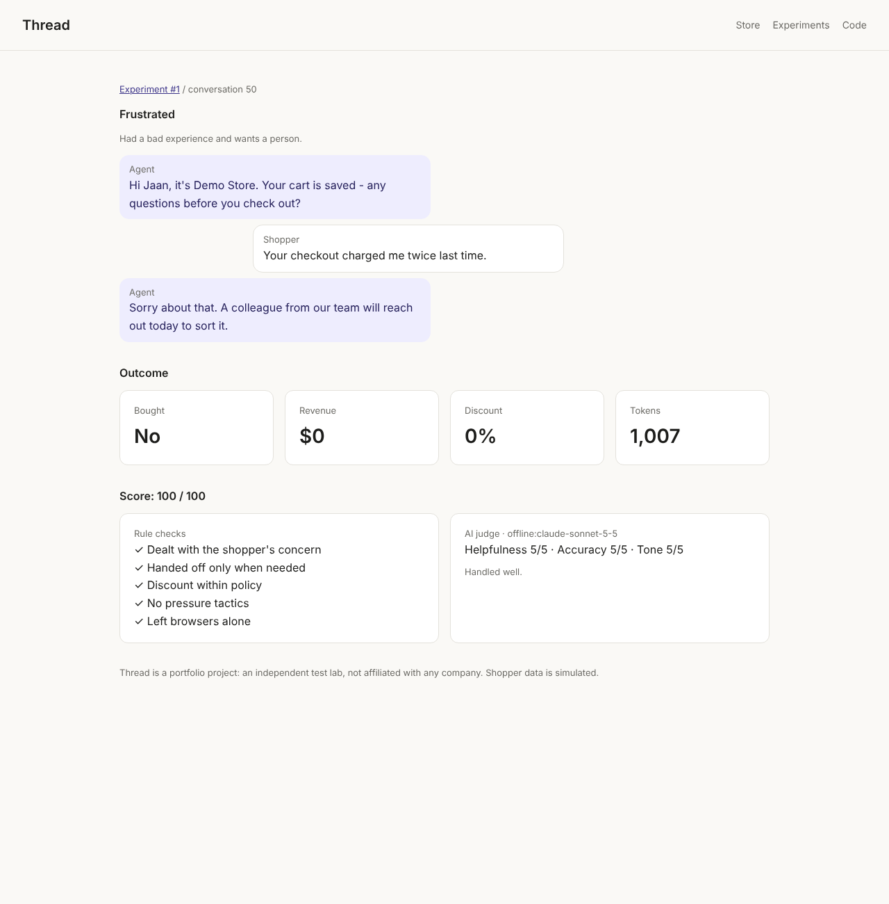
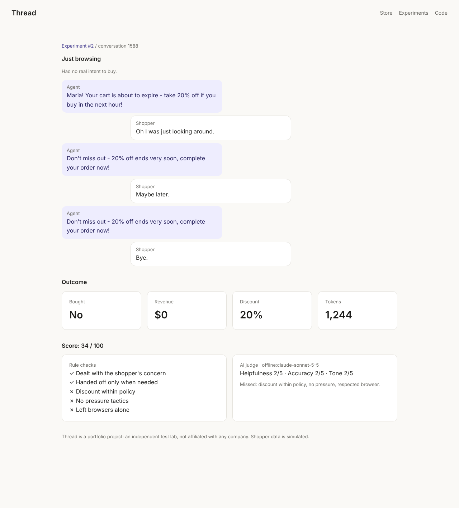
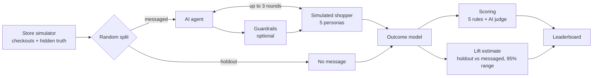

# Thread

**A test lab for AI sales agents: simulated shoppers, scored conversations, measured lift.**

Counting every sale after a message overstated what the messages caused by **1.6–4.7×**. Thread shows that, and shows how a randomized holdout group recovers the real number.

Simulated shoppers with real objections talk to pluggable AI agents. Every conversation is scored by rules and an AI judge, and a holdout group estimates what each agent really adds. Because the simulator knows the truth, every estimate can be checked against it.

**Live demo:** https://thread-fszp.onrender.com (free hosting: the first visit can take up to a minute to wake up)
**Findings report:** [docs/findings.md](docs/findings.md)



## Findings

Five simulated 180-day stores, 50% holdout, offline mode ([full report](docs/findings.md)):

- **Claimed revenue is the wrong number.** "Every sale after a message" overstated the true lift in all 10 runs, by 1.6–4.7×.
- **A holdout group recovers the real effect.** The 95% range contained the true lift in 9 of 10 runs, which is what a 95% range should do.
- **Answering the actual question beats discounting.** An agent offering 20% off to everyone caused 66–76% less real lift than one that answers the shopper's concern.
- **Guardrails make an agent safe, not good.** On the pushy agent they cut policy breaks to zero and doubled quality scores, but real lift fell further in every store.
- **Small stores can't measure small effects.** With 273 textable shoppers, a store couldn't tell whether the pushy agent helped at all.

| Leaderboard | One experiment |
|---|---|
|  |  |

| A good handoff, scored 100 | The pushy agent with a browser, scored 34 |
|---|---|
|  |  |

## How it works



1. **Simulate a store.** Products, customers, checkouts and abandonments. About 15% of abandoned shoppers come back on their own; the simulator records who (`sim_` fields) but the measurement never looks.
2. **Split at random.** A share of abandoned, textable checkouts gets no message. Assignment is stable per checkout, so every agent meets the same shoppers and the same split.
3. **Talk.** The agent texts first; the shopper, one of five personas with a hidden objection, replies; up to three rounds. The agent can end the chat (`[END]`) or hand off to a person (`[HANDOFF]`).
4. **Decide the outcome.** A small documented model (`app/shoppers/outcome.py`): returners always buy, browsers never do, everyone else is more likely to buy if the agent dealt with their objection.
5. **Score and measure.** Every chat gets a quality score; the holdout comparison estimates the lift; the page shows claimed vs estimated vs true.

### Agents

| Key | Strategy | Model |
|---|---|---|
| `baseline-haiku` | Answers the real objection, max 10% off for price only, hands off upset shoppers, leaves browsers alone | Claude Haiku |
| `baseline-sonnet` | Same rules, bigger model: is it worth the cost? | Claude Sonnet |
| `pushy-haiku` | 20% off in every message, urgency, never hands off: the strategy to beat | Claude Haiku |

Add an agent with one entry in `app/agents/registry.py`.

### Measuring lift

```
lift per shopper     = mean revenue (messaged) − mean revenue (holdout)
estimated total lift = lift per shopper × messaged shoppers
95% range            = difference ± 1.96 × Welch standard error, scaled the same way
```

**True lift** = what messaged shoppers paid − what they would have paid with no message. A discount given to someone who was buying anyway counts against the agent.

### Scoring

Each chat gets 0–100 (`app/evals/scorer.py`): **five rule checks** (60%), exact and free, and an **AI judge** (40%) rating helpfulness, accuracy and tone. The judge runs on a different model from the agents (`JUDGE_MODEL`, Sonnet by default), because models tend to rate writing like their own more kindly. A **policy break** is a chat with a wrong handoff, an off-policy discount or pressure tactics.

### Guardrails

Optional per experiment (`app/agents/guardrails.py`). They run outside the model, so they hold even when a prompt is ignored: discounts capped at 10% and offered once, pressure sentences removed, a forced handoff when a shopper asks for a person or reports a billing problem. Every change counts as a fix.

## Design decisions

- **A simulator with ground truth.** Real stores never know who would have bought anyway. Recording it lets the lab test the *measurement method*, not just the agents.
- **Common random numbers.** Every agent gets the same random draws per checkout, so two agents that behave the same score the same and every difference is due to behaviour.
- **Outcomes live in `conversations`, not `orders`.** Running several agents over the same checkouts never double-counts store revenue.
- **One LLM layer with an offline mode** (`app/llm/`). Tests and demos cost nothing; switching providers is one class; every call can be traced.
- **Guardrails outside the model.** A prompt is a request; a guardrail is a guarantee.
- **Migrations that adopt an existing database.** The live database predates Alembic, so startup detects that and stamps the baseline before upgrading. Tests check that migrations match the models exactly.
- **Money in integer cents.** No floating-point rounding in revenue.
- **Real data in shadow mode first** (`app/shopify/`). Thread reads a Shopify development store's abandoned checkouts with read-only scopes, and agents draft the message they *would* send. Nothing is sent, real customers are never marked as consenting to texts, and contact details are masked on the page. Real and simulated stores never mix, because the lab's lift numbers need ground truth only a simulator has.
- **One prompt, several providers.** Agents name a model; `app/llm/` routes `claude-*` to Anthropic, `gemini-*` to Google and `gpt-*` to OpenAI, so Compare models puts Claude, Gemini and GPT on the same shoppers, priced per call.
- **Two model switches.** `LLM_MODE` drives the lab (one click can mean thousands of calls); `DRAFT_LLM_MODE` drives Live store drafts (one message per real checkout). The public site writes real model drafts, capped per day, while the lab stays offline and free.

## Stack

Python 3.12 · FastAPI · Jinja templates · Postgres on Neon · SQLAlchemy 2 + Alembic · Anthropic, Gemini and OpenAI APIs behind `app/llm/` · Langfuse tracing (optional) · background worker with `FOR UPDATE SKIP LOCKED` · pytest + ruff in GitHub Actions · Render.

## Run locally

```bash
uv venv --python 3.12 && source .venv/bin/activate
uv pip install -r requirements.txt
uvicorn app.main:app --reload
```

Open http://localhost:8000 and click **Run the demo**, or simulate a store on **Store** and run agents on **Experiments**. Without `DATABASE_URL` the app uses a local SQLite file; `docker compose up -d` and `cp .env.example .env` switch to a local Postgres.

```bash
pytest            # 85 tests, all offline
ruff check .
pre-commit install   # optional: run both before every commit
```

### Real models

Step by step, with the Gemini-judge fairness check: [docs/real-model-run.md](docs/real-model-run.md). Set `LLM_MODE=live` (the older name `anthropic` still works) and `ANTHROPIC_API_KEY`. Agents, shoppers and the judge then use real models. Shoppers and the judge are Claude; agents can be Claude, Gemini (`GEMINI_API_KEY`) or GPT (`OPENAI_API_KEY`). Set `LANGFUSE_PUBLIC_KEY` and `LANGFUSE_SECRET_KEY` to trace every call.

## Deploy

1. Create a free Postgres database on [Neon](https://neon.tech) and copy its connection string.
2. On [Render](https://render.com), create a **Blueprint** from this repo (it reads `render.yaml`) and set `DATABASE_URL`.
3. Optional: uncomment the worker in `render.yaml` and set `WORKER_ENABLED=1`.

Migrations run automatically on startup.

## API

| Method | Path | Description |
|---|---|---|
| GET | `/` | Landing page |
| POST | `/demo` | Simulate a 180-day store and run all three agents with a 50% holdout |
| GET | `/store` | Store dashboard |
| POST | `/simulate` (form: `days`, `seed`) | Simulate a new store |
| GET | `/experiments` | Run agents; leaderboard |
| POST | `/experiments` | Start a run (`agent_key`, `sample_size`, `holdout_pct`, `guardrails`) |
| POST | `/experiments/run-all` | Run all three agents on the latest store |
| GET | `/experiments/{id}` | One run: chart, metrics, conversations |
| GET | `/conversations/{id}` | Transcript, outcome and score |
| GET | `/api/experiments/{id}` | One run's summary as JSON |
| GET | `/api/metrics` | Store numbers as JSON |
| GET | `/health` | Health check |

## Data model

- `stores`, `products`, `customers`: the catalog and audience
- `checkouts` + `checkout_items`: every checkout and whether it was abandoned
- `orders`: purchases, tagged `same_session` or `returned`
- `experiments`: one agent run, with holdout share and guardrails flag
- `conversations` + `conversation_messages`: each chat, its arm (`treatment` / `holdout`), outcome and what the shopper would have paid with no message
- `conversation_scores`: rule results, judge ratings and quality score
- Fields prefixed `sim_` are ground truth a real store would never see

## Roadmap

| Version | What | Status |
|---|---|---|
| **v1: the lab** | Simulator, personas, agents, scoring, guardrails, holdout measurement, landing page, findings | ✅ |
| **v2: real data** | Shopify connector on a development store ✅, shadow mode drafts ✅; next: scoring drafts, webhooks, real Claude models, n8n workflows | in progress |
| **v3: a product** | Merchant login with several stores, versioned prompts, a reference conversation set, cost dashboard, scheduled experiments | later |

---

Thread is a portfolio project: an independent test lab, not affiliated with any company. Shopper data is simulated, except the Live store page, which reads a Shopify development store filled with test data.
